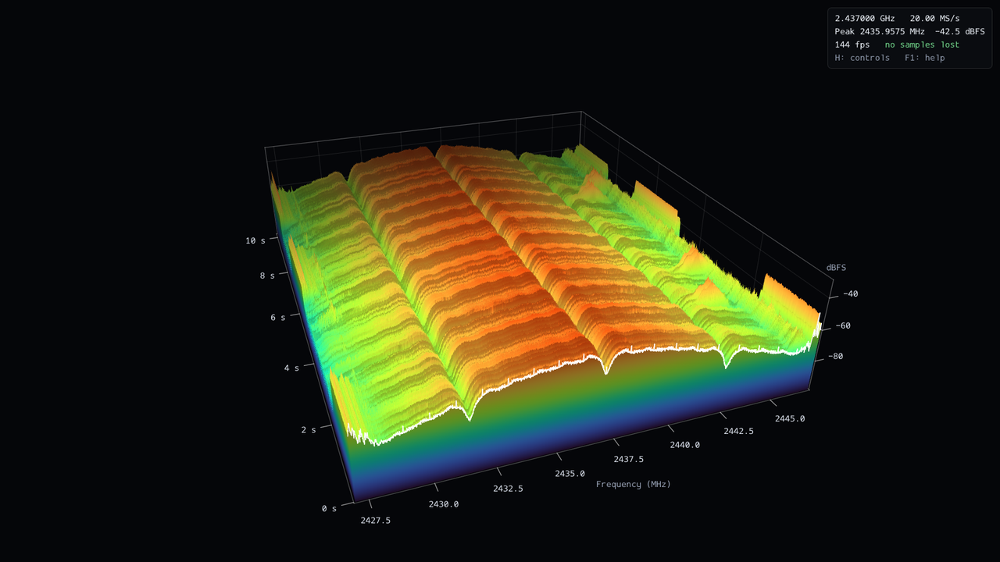
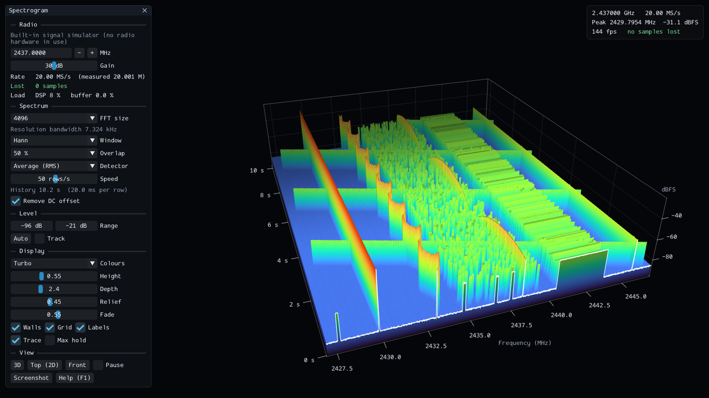
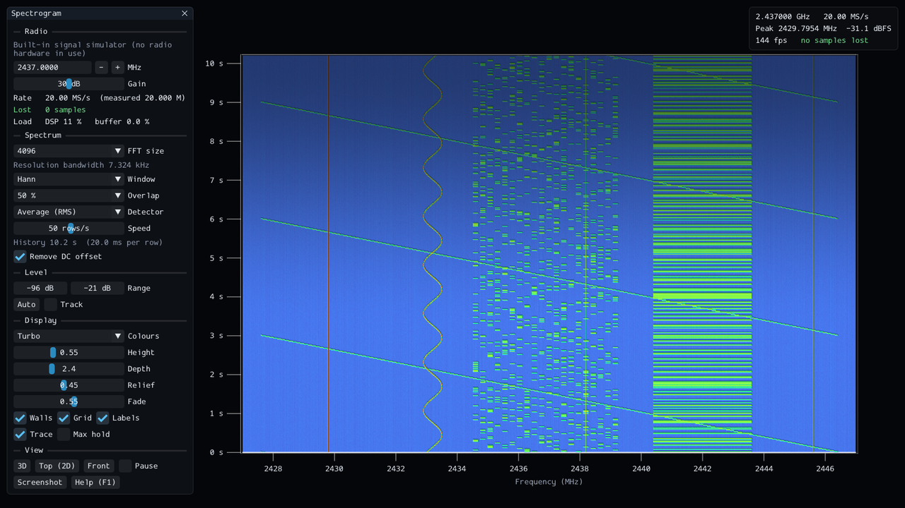
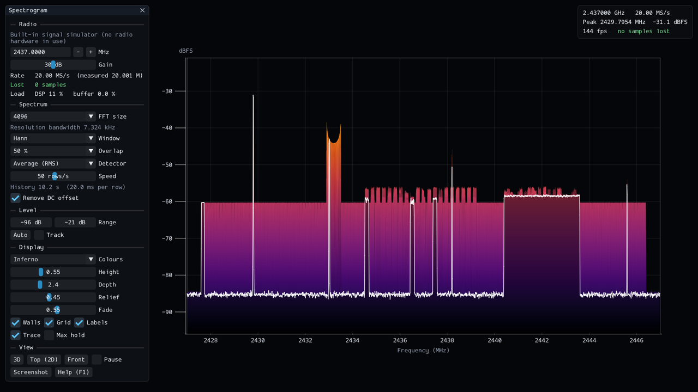

# Spectrogram

A real-time 3D RF spectrogram (waterfall) for the Nuand bladeRF and for RTL-SDR
dongles, written in C++20 and rendered with Vulkan. It streams IQ samples at
20 MS/s from a bladeRF (2.4 MS/s from an RTL-SDR), runs an FFT over
every one of them, and draws the result as a scrolling height field you can fly
around — or flatten into a classic 2D waterfall or spectrum-analyser view.
Ctrl + click an FM signal, a two-way radio channel or a broadcast station, to
hear it.



*A busy Wi-Fi channel at 2.437 GHz, received with a bladeRF x115 at 20 MS/s. The
three valleys running back in time are the spectral nulls of an 802.11b signal.*

The same data can be shown from any angle. Below: the built-in signal simulator
in the 3D view with the control panel, as a 2D waterfall, and as a spectrum.

| 3D view | Top view: 2D waterfall | Front view: spectrum |
| --- | --- | --- |
|  |  |  |

## Features

- **Lossless 20 MS/s streaming** from a bladeRF over USB 3, with per-block
  timestamps so every dropped sample is detected and counted on screen.
- **No samples skipped**: overlapping, windowed FFTs cover the whole stream
  (9 766 FFTs per second at the default settings), averaged or peak-held into
  rows that each represent an exact amount of signal time.
- **3D, 2D and spectrum views** of the same data, with frequency, level and
  time axes, a live trace, optional max hold, and a cursor readout of the
  frequency, level and age of whatever is under the mouse.
- **FM audio**: Ctrl + click a signal to hear it, narrowband (two-way radio
  voice) or wideband (broadcast, in mono). A box in the plot marks the channel
  being played. The receiver finds the carrier near the click, applies the
  de-emphasis and audio filtering that the kind of FM calls for and an optional
  squelch, and keeps the audio in step with the sound card's clock.
- **RTL-SDR dongles** (RTL2832U with an R820T/R828D, E4000, FC0012/13 or
  FC2580 tuner) work too, at up to 3.2 MS/s: `--source rtlsdr`.
- **Live control** of centre frequency, gain, FFT size (256 to 262 144), window,
  overlap, detector, waterfall speed, level scale and colour map.
- **Runs without the radio** too: a built-in signal simulator and playback of
  IQ recordings use exactly the same processing and display path.

## Building

Requirements: Linux, a C++20 compiler (developed with GCC 15), CMake 3.28 or
newer, and the development packages of **libbladeRF**, **FFTW 3** (single
precision) and **zlib**. **librtlsdr** is optional and adds RTL-SDR support. On
Debian/Ubuntu:

```sh
sudo apt install build-essential cmake ninja-build pkg-config \
                 libbladerf-dev librtlsdr-dev libfftw3-dev zlib1g-dev
```

Then:

```sh
cmake -S . -B build -G Ninja
cmake --build build
./build/spectrogram
```

The remaining dependencies are used from the system when installed and
otherwise downloaded into the build directory (pinned versions, checked against
SHA-256 hashes; nothing is installed system-wide):

| Dependency | System package used if present | Otherwise |
| --- | --- | --- |
| Vulkan headers | `libvulkan-dev` | headers fetched; links the Vulkan loader that ships with your GPU driver |
| GLFW | `libglfw3-dev` | headers fetched if the GLFW 3.4+ runtime library is installed, else built from source |
| GLSL compiler | `glslc` or `glslang-tools` | glslang built from source (needs Python 3; adds about half a minute to the first build) |
| Dear ImGui | — | always fetched and compiled in |
| miniaudio (sound output) | — | always fetched and compiled in |

Sound goes out through PulseAudio / PipeWire, ALSA or JACK, whichever is
running; building needs none of their development packages.

At run time you need a Vulkan-capable GPU driver (e.g. `mesa-vulkan-drivers`).

CMake options:

| Option | Default | Meaning |
| --- | --- | --- |
| `SPECTRO_BUILD_GUI` | `ON` | `OFF` builds only the headless tool and the tests; needs no graphics libraries |
| `SPECTRO_WITH_BLADERF` | `ON` | `OFF` builds without bladeRF support |
| `SPECTRO_WITH_RTLSDR` | `ON` | `OFF` builds without RTL-SDR support |
| `SPECTRO_WITH_AUDIO` | `ON` | `OFF` builds without sound output (signals cannot be listened to) |
| `SPECTRO_BUILD_TESTS` | `ON` | Build the unit tests (`ctest --test-dir build`) |
| `SPECTRO_NATIVE_ARCH` | `ON` | Compile for this machine's CPU (`-march=native`) |
| `SPECTRO_FETCH_MISSING` | `ON` | Allow downloading the dependencies listed above |

If libbladeRF is not found, CMake warns and builds the program without bladeRF
support; if librtlsdr is not found, it builds without RTL-SDR support. Without
either, the simulator and file playback still work.

## Running

```sh
./build/spectrogram                                # bladeRF, 2.437 GHz, 20 MS/s
./build/spectrogram --freq 915M --gain 40          # another band
./build/spectrogram --freq 2.45G --rate 40M        # 40 MHz wide, the bladeRF x115's maximum
./build/spectrogram --source rtlsdr                # RTL-SDR, 100 MHz, 2.4 MS/s
./build/spectrogram --source rtlsdr --freq 433.92M --rate 1M --ppm 20
./build/spectrogram --source sim                   # simulator, no hardware needed
./build/spectrogram --source sim --listen 2431.4M  # ... and listen to its FM voice channel
./build/spectrogram --source rtlsdr --freq 162.475M --listen 162.425M --listen-bw 16k   # NOAA weather radio
./build/spectrogram --source rtlsdr --freq 100M --listen 100.3M --listen-bw 200k        # an FM broadcast station
./build/spectrogram --file capture.sc16 --rate 20M --freq 2.437G
```

Frequencies and rates accept `k`, `M` and `G` suffixes. `--help` lists every
option; the most useful ones:

| Option | Meaning |
| --- | --- |
| `--source bladerf\|rtlsdr\|sim\|file` | Where the samples come from (default `bladerf`) |
| `--freq`, `--rate`, `--gain`, `--bw` | Tuning, sample rate, gain, analog bandwidth |
| `--device ID` | Which radio, if several are connected (RTL-SDR: serial number or index) |
| `--ppm N` | RTL-SDR: correct the crystal's frequency error |
| `--fft N`, `--window`, `--overlap`, `--detector` | Spectrum estimation |
| `--bins N`, `--history ROWS` | Size of the spectrogram grid (default 2048 × 512) |
| `--view 3d\|top\|front`, `--colormap NAME` | Initial view and colours |
| `--gpu SEL`, `--list-gpus` | Choose the GPU (a discrete GPU is preferred by default) |
| `--msaa N`, `--no-vsync`, `--x11`, `--wayland` | Rendering and windowing |
| `--listen HZ`, `--listen-bw HZ` | Play the FM signal at this frequency, in a channel this wide: 5k to 25k is narrowband FM (default 12.5k), 100k to 300k wideband |
| `--deemphasis 75\|50` | Wideband FM de-emphasis in µs: 75 (the Americas, South Korea; default) or 50 (elsewhere) |
| `--volume PCT`, `--squelch DB` | Audio volume (default 50) and squelch threshold in dBFS (default off) |
| `--headless --duration SEC` | No window: print stream statistics (see below) |

File playback understands `sc16` (the bladeRF's own format, as written by
`bladeRF-cli` with `format=bin`), `cs16`, `cf32`, `cs8` and `cu8`; the format is
taken from the file extension unless `--format` says otherwise. A recording is
repeated endlessly (each restart counts as a stream break) unless `--no-loop` is
given.

### RTL-SDR

`--source rtlsdr` selects the first RTL-SDR dongle. Things that differ from the
bladeRF:

- **Defaults** are 100 MHz and 2.4 MS/s. The RTL2832 offers 225.001 to 300 kS/s
  and 900.001 kS/s to 3.2 MS/s; above 2.4 MS/s most dongles lose samples.
- **Lost samples cannot be detected.** The dongle does not timestamp its
  samples, so the "lost" counter only shows samples this program failed to
  take over in time, not those lost in the dongle or on the USB bus.
- **Gain** comes in the tuner's fixed steps (29 of them between 0 and 49.6 dB
  on an R820T); the nearest one is used. `--agc` selects the tuner's automatic gain.
- **Samples are 8 bits wide**, so the dynamic range is much smaller than the
  bladeRF's 12 bits; levels are still in dBFS of the converter's full scale.
- The tuning range is that of the tuner (24 MHz to 1.766 GHz for the R820T).
  Direct sampling (HF) and the bias tee are not supported.

### Listening to FM

Hold Ctrl and click a signal in the plot to hear it; `L` turns the sound on and
off. A box marks the channel being played. It is as wide as the channel
filter, as deep as the history and as tall as the level scale. It is bright
while there is something to hear and dim while the squelch mutes it. A small
window next to the plot sets the frequency, the channel width, the volume and
the squelch.

- **A click finds the carrier.** One column of the display often spans more
  than a channel (10 kHz at 20 MS/s), and a hand is not much more precise. So
  after a click the receiver looks for the strongest signal near that spot and
  centres the channel on it. Ctrl + drag places the channel exactly where the
  cursor is; a frequency typed into the window is taken as it is.
- **The channel stays put when you retune.** It is an absolute frequency. If it
  leaves the received band, it goes quiet until you tune back.
- **The channel width chooses the kind of FM.**
  - *Narrowband* (8 to 25 kHz), for two-way radio. 12.5 kHz suits ±2.5 kHz
    deviation; use 16 kHz or more for ±5 kHz, e.g. NOAA weather radio. A
    deviation of 0.4 × the channel width is full scale. Voice processing as on
    a two-way radio: 750 µs de-emphasis and a 300 Hz to 3.4 kHz band-pass,
    which also attenuates sub-audible (CTCSS) tones.
  - *Wideband* (100 to 250 kHz), for broadcast stations; 200 kHz is the usual
    choice, 150 kHz helps against a strong neighbour. ±75 kHz deviation is
    full scale. The audio is mono (left + right) up to 15 kHz. The stereo pilot
    and subcarrier are filtered out; stereo and RDS are not decoded.
    De-emphasis is 75 µs as in the Americas and South Korea, or 50 µs as
    everywhere else: choose it in the window or with `--deemphasis`.
- **Squelch**: the window shows the power in the channel, in dBFS like the
  plot. Set the threshold a few dB above the level of the empty channel; "off"
  plays the noise too.
- **Sound** goes to the default output device. The audio is kept in step with
  the sound card's clock by adjusting its rate by up to 0.5 %, so it neither
  runs dry nor piles up; it lags the radio by about a tenth of a second.
- The built-in simulator has two stations for trying this out. A narrowband
  channel plays a tune 0.28 × the sample rate below its starting frequency
  (2431.4 MHz by default). A broadcast station plays an arpeggio 0.38 × the
  sample rate above it (2444.6 MHz); it is only on air at sample rates of
  2 MS/s and up.

### Controls

| Input | Action |
| --- | --- |
| Left drag | Rotate the view |
| Right or middle drag, Shift + left drag | Move the view |
| Mouse wheel | Zoom |
| Double click, `R` | Reset the view |
| Ctrl + click | Listen to the signal under the cursor (FM) |
| Ctrl + drag | Slide the channel being listened to |
| `L` | Sound on / off |
| `1` / `2` / `3` | 3D view / top view (2D waterfall) / front view (spectrum) |
| `←` / `→` | Tune down / up by 1/20 of the span (Shift: 1/200, Ctrl: half the span) |
| `↑` / `↓` | Gain up / down (Shift: 5 dB steps) |
| `[` / `]` | Halve / double the FFT size |
| `,` / `.` | Slower / faster waterfall |
| `A` | Fit the level scale to the signal |
| `C` / Shift + `C` | Next / previous colour map |
| `M` | Max hold trace |
| `G` / `W` / `T` | Toggle grid / walls / live trace |
| Space | Pause the display (the radio keeps streaming) |
| `P`, `F12` | Save a screenshot (PNG, in the current directory) |
| `F`, `F11` | Full screen |
| `H` | Show / hide the control panel |
| `F1` | Help |
| Ctrl + `Q` | Quit |

Hovering over the plot shows the frequency, level and age of the point under
the cursor.

### Reading the display

- **Levels are in dBFS**: 0 dBFS is a full-scale sine wave at the converter.
  They are not calibrated to dBm; changing the gain moves everything.
- The **noise floor depends on the resolution bandwidth** (shown in the panel):
  doubling the FFT size lowers it by 3 dB while carriers stay put.
- With more FFT bins than display columns, each column shows the strongest bin
  it covers, so a narrow carrier never disappears between columns.
- **Average** shows true mean power over each row; **Peak** shows the maximum,
  which makes short bursts stand out.
- "Remove DC offset" cancels the spike that direct-conversion receivers such as
  the bladeRF leave at the centre frequency. Turn it off if you are looking at
  a carrier exactly at the centre.
- A row at the floor level across the whole band marks a break in time: a
  retune, a pause, or rows the display had to skip.

## Checking your setup

```sh
./build/spectrogram --headless --duration 10      # stream health, no window
```

prints the measured sample rate, lost samples, processing load and the
strongest signal once per second, and a summary at the end.
`--spectrum-csv FILE` also writes the time-averaged spectrum.

```sh
./build/spectrogram --self-test                   # add --source sim to test without the radio
```

runs a 15-second scripted tour (views, window sizes, FFT sizes, retuning,
pausing, cursor readout, listening to a narrowband and a wideband FM signal)
and reports `Self-test PASSED` or `FAILED`. The listening part is silent
unless `--volume` is given. Add `--validate` to run it under the Vulkan
validation layers if they are installed (`vulkan-validationlayers`).

```sh
ctest --test-dir build --output-on-failure        # unit tests
```

## How it works

```
 radio ────USB────▶ receive thread ──▶ IQ ring ──▶ DSP thread ──▶ row queue ──▶ render thread ──▶ GPU
                    (libbladeRF /      (lock-free,  (window, FFT,   (lock-free)   (Vulkan,
                     librtlsdr)         ~0.4 s)      average/peak)                 Dear ImGui)
                          │
                          └──▶ IQ ring ──▶ audio thread ──▶ audio FIFO ──▶ sound card
                       (only while       (FM demodulator)  (lock-free)     (miniaudio)
                        listening)
```

- **Receive thread** (`src/radio/`). Reads timestamped blocks from libbladeRF
  straight into a lock-free ring buffer and does nothing else, so the device is
  always serviced. A jump in the FPGA's sample timestamps is counted as lost
  samples. librtlsdr delivers samples on a thread of its own, which only
  copies them into a FIFO; the receive thread converts them from 8 to 16 bits.
- **DSP thread** (`src/dsp/`). Windows each frame directly out of the ring
  buffer, runs FFTW, and accumulates power. One row is a fixed number of frames,
  i.e. an exact amount of signal time. The DC offset is cancelled in the
  frequency domain, where it only touches the nine bins a windowed constant
  occupies. Changing the FFT size never stalls the stream: plans are prepared on
  a separate thread while the old one keeps running.
- **Audio thread** (`src/audio/`, `src/dsp/fm_demod.cpp`). While listening,
  the receive thread also copies every block into a second ring buffer, from
  which this thread demodulates the chosen channel. A single FIR filter, whose
  complex taps include the frequency shift, moves the channel to 0 Hz and
  decimates it: to about 100 kS/s for narrowband FM, 1.2 MS/s for wideband. It
  is the only stage that runs at the full sample rate. A polyphase resampler,
  whose prototype is the channel filter, feeds the phase discriminator. For
  narrowband FM it runs at the audio rate of 48 kHz, followed by de-emphasis,
  a voice band-pass and the squelch. For wideband FM it runs at 384 kHz,
  followed by de-emphasis and a 15 kHz low-pass that also brings the rate down
  to 48 kHz. The resampler's rate is trimmed to keep the amount of audio
  waiting for the sound card steady, which absorbs the difference between the
  radio's clock and the sound card's.
- **Renderer** (`src/gfx/`, `shaders/`). The spectrogram lives in a single
  float texture used as a ring buffer: one texel per frequency bin and row,
  holding dBFS. There is no vertex buffer; the vertex shader derives the grid
  from the vertex and instance index and reads its height from the texture. A
  new spectrum therefore costs one row upload, and changing the level scale
  re-maps the entire history instantly. Rows arrive in small bursts, so the
  display follows a continuous scroll position and shifts the surface by
  fractions of a row to keep the motion smooth.
- **Interface** (`src/ui/`, `src/app/`). Dear ImGui for the panel; axis labels
  are placed by projecting their 3D anchor points to the screen. The cursor
  readout marches the view ray across a CPU copy of the height field.

Only core Vulkan 1.0 is used, with no optional device features.

### Source layout

```
src/radio/    IqSource interface; bladeRF, RTL-SDR, simulator and file sources; receive thread
src/dsp/      windows, SpectrumEngine (FFT, averaging, rows), FM demodulator (narrowband and wideband)
src/audio/    listening: audio thread, audio FIFO, rate matching, sound output
src/gfx/      Vulkan context and swapchain, renderer, camera, colour maps, PNG writer
src/ui/       Dear ImGui integration; 3D axes, grid and labels
src/app/      command line, pipeline wiring, the interactive application, headless mode
src/util/     lock-free IQ ring buffer, logging, units, small 3D math
shaders/      GLSL, compiled to SPIR-V and embedded in the executable at build time
tests/        unit tests of the ring buffer, DSP, sources, demodulator, audio path and option parsing
tools/        gen_colormaps.py, which regenerates src/gfx/colormap_data.inc
cmake/        dependency discovery and shader compilation
```

### Measured on the development machine

Intel Core i7-12700H, Intel Arc A550M + Iris Xe, bladeRF x115 on a USB 3 port,
Ubuntu 26.04, Mesa 26:

- 1.2 billion samples received in 60 s at 20 MS/s with the display running at
  144 fps: no stream breaks, no lost samples, about 40 % of one CPU core in
  total. Retuning and changing the gain while streaming loses nothing either.
- 5, 10, 30 and 40 MS/s are equally lossless; at 40 MS/s the DSP thread uses
  between a third and a half of a core.
- The DSP thread can process about 480 MS/s at the default settings — more than
  twenty times what the radio delivers.
- Listening: the FM demodulator takes 0.7 % (narrowband) or 3.3 % (wideband)
  of one core at 2.4 MS/s, and 1.8 % or 5.4 % at 20 MS/s.
- Unthrottled frame rate at 1600 × 900 with the default 2048 × 512 grid and
  4× anti-aliasing: about 440 fps on the Arc A550M, 200 fps on the Iris Xe.
- `--self-test --validate` passes on both GPUs and on Mesa's software renderer,
  under Wayland and X11, with the Vulkan validation layers (including
  synchronisation validation) reporting nothing.

## Troubleshooting

- **"Could not open the bladeRF: No devices available"** — check the cable, that
  no other program (bladeRF-cli, GNU Radio, …) has the device open, and that
  your user may access it (the udev rules shipped with libbladeRF; membership of
  the `plugdev` group).
- **"Could not open the RTL-SDR"** — error −3 means your user may not access
  the dongle (install the udev rules from the `rtl-sdr` package and replug it);
  error −6 means another program has it open, or the kernel's DVB-T driver
  does and could not be detached (`sudo rmmod dvb_usb_rtl28xxu`).
- **Samples are being lost** — use a USB 3 port directly on the computer, not a
  hub, and a USB 3 cable. A USB 2 link cannot carry 20 MS/s; the program warns
  at start-up when the radio is on one.
- **Low frame rate** — pick the faster GPU with `--gpu` (see `--list-gpus`), or
  reduce the work with `--msaa 1`, `--bins 1024` or `--history 256`.
- **The window stops updating while hidden** — some Wayland setups hold back
  the frames of windows that are not visible. The radio keeps streaming and the
  display catches up when the window is shown again; `--no-vsync` or `--x11`
  usually avoid it. (Pressing Ctrl-C twice in the terminal always quits.)
- **Nothing to hear** — the listening window says whether the channel is
  outside the received band or muted by the squelch, and shows its level. An
  FM signal less than about 10 dB above the noise in its channel sounds mostly
  like noise: compare the level with that of an empty channel nearby.
- **A broadcast station sounds quiet and distorted** — it needs a wideband
  channel width (100 kHz or more); with a narrowband one only a sliver of it
  gets through.
- **"No sound device was found"** — no output device could be opened, so the
  audio goes nowhere. Check that PulseAudio or PipeWire is running
  (`wpctl status`).
- **Everything is at the top or the bottom of the colour scale** — press `A` to
  fit the level scale, and adjust the gain so that strong signals stay below
  about −10 dBFS.
- **`--agc` says automatic gain control is unavailable** — the bladeRF x115 only
  offers AGC once a DC calibration table has been generated for it (see
  ["Generating a DC offset table"](https://github.com/Nuand/bladeRF/wiki/DC-offset-and-IQ-Imbalance-Correction)
  in the bladeRF wiki); until then the program carries on with the fixed `--gain`.

## Limitations

- Developed and tested on Linux with a bladeRF x115, at 5 to 40 MS/s. The
  bladeRF 2.0 micro uses the same libbladeRF calls and should work, but has not
  been tried; neither have other operating systems.
- RTL-SDR support was tested with an R820T dongle only.
- Receive only, one channel.
- Audio: FM only, narrowband or wideband in mono (no AM or SSB, no stereo or
  RDS), one channel at a time. Both kinds were checked against synthetic
  signals and the built-in simulator. Wideband FM was also checked on real
  broadcasts received with an RTL-SDR, where it matches an independent
  reference receiver. Narrowband FM was tried live only on weak real-world
  signals.

## Third-party software

libbladeRF (LGPL-2.1-or-later), librtlsdr (GPL-2.0-or-later), FFTW (GPL-2.0-or-later), GLFW (zlib licence),
Dear ImGui (MIT), miniaudio (public domain or MIT No Attribution), Vulkan
headers (Apache-2.0 / MIT), glslang (BSD-3-Clause and others; used at build
time only) and zlib. The colour maps Turbo (Apache-2.0,
Google) and Inferno, Magma, Plasma and Viridis (CC0) are taken from matplotlib.

Note that FFTW is licensed under the GPL: if you distribute binaries of this
program, the GPL's terms apply to them.
