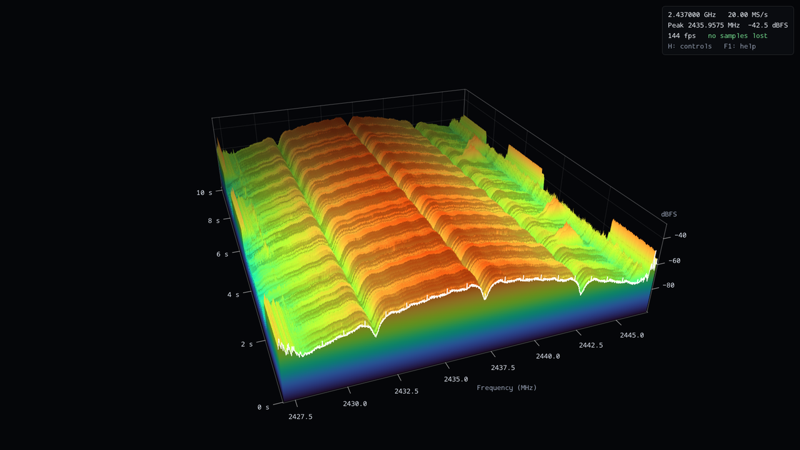
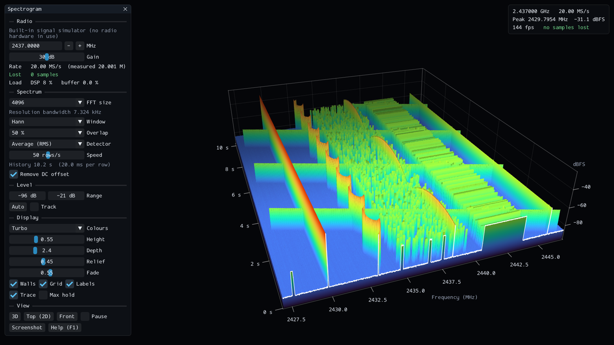
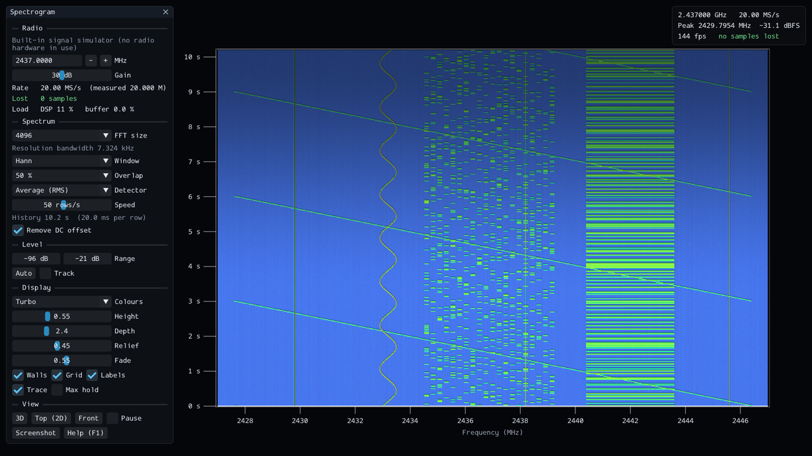
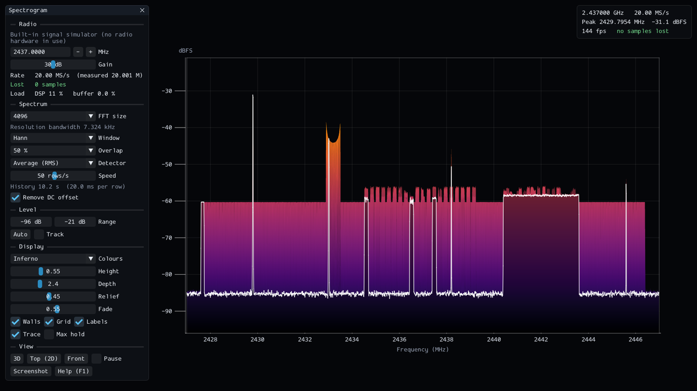

# Spectrogram

A real-time 3D RF spectrogram (waterfall) for the Nuand bladeRF and for RTL-SDR
dongles, written in C++20 and rendered with Vulkan. It streams IQ samples at
20 MS/s from a bladeRF (2.4 MS/s from an RTL-SDR), runs an FFT over
every one of them, and draws the result as a scrolling height field you can fly
around — or flatten into a classic 2D waterfall or spectrum-analyser view.
Ctrl + click an FM signal, a two-way radio channel or a broadcast station, to
hear it.



*A busy Wi-Fi channel at 2.437 GHz, received with a bladeRF x115 at 20 MS/s. The
three valleys running back in time are the spectral nulls of an 802.11b signal.*

The same data can be shown from any angle. Below: the built-in signal simulator
in the 3D view with the control panel, as a 2D waterfall, and as a spectrum.

| 3D view | Top view: 2D waterfall | Front view: spectrum |
| --- | --- | --- |
|  |  |  |

## Features

- **Lossless 20 MS/s streaming** from a bladeRF over USB 3, with per-block
  timestamps so every dropped sample is detected and counted on screen.
- **No samples skipped**: overlapping, windowed FFTs cover the whole stream
  (9 766 FFTs per second at the default settings), averaged or peak-held into
  rows that each represent an exact amount of signal time.
- **3D, 2D and spectrum views** of the same data, with frequency, level and
  time axes, a live trace, optional max hold, and a cursor readout of the
  frequency, level and age of whatever is under the mouse.
- **FM audio**: Ctrl + click a signal to hear it, narrowband (two-way radio
  voice) or wideband (broadcast, in mono). A box in the plot marks the channel
  being played. The receiver finds the carrier near the click, applies the
  de-emphasis and audio filtering that the kind of FM calls for and an optional
  squelch, and keeps the audio in step with the sound card's clock.
- **DMR and P25**: a DMR or P25 (Phase 1 or Phase 2) channel is decoded
  rather than played as FM: who is calling whom (talkgroup and radio IDs),
  whether the call is encrypted, the repeater's colour code or the network
  access code, and the voice of a clear call through the AMBE+2 or IMBE
  vocoder (an optional part of the build, see [Digital voice](#digital-voice)).
  On a P25 trunked system's control channel it can **follow the calls** it
  grants to their voice channels and back; given a list of the system's
  control channels, it finds the one on the air, and looks again when that
  one is lost.
- **Speech to text**: what is said in DMR and P25 calls can be written out,
  with who said it, by OpenAI's Whisper running on the computer itself
  through whisper.cpp (an optional part of the build, see
  [Speech to text](#speech-to-text)).
- **Scanning**: or let it find the signals. It stops on each one above a
  threshold, works out whether it is narrowband or wideband FM, stays while it
  is on the air, then moves on to the next.
- **RTL-SDR dongles** (RTL2832U with an R820T/R828D, E4000, FC0012/13 or
  FC2580 tuner) work too, at up to 3.2 MS/s: `--source rtlsdr`.
- **Live control** of centre frequency, gain, FFT size (256 to 262 144), window,
  overlap, detector, waterfall speed, level scale and colour map.
- **Runs without the radio** too: a built-in signal simulator and playback of
  IQ recordings use exactly the same processing and display path.

## Building

Requirements: Linux or macOS, a C++20 compiler (GCC, Clang or Apple Clang),
CMake 3.28 or newer, and the development packages of **FFTW 3** (single
precision) and **zlib**. **libbladeRF** and **librtlsdr** are optional and add
hardware radio support (without them, the simulator and file playback still
work).

### Linux (Debian/Ubuntu)

```sh
sudo apt update
sudo apt install build-essential cmake ninja-build pkg-config \
                 libbladerf-dev librtlsdr-dev libfftw3-dev zlib1g-dev \
                 libxkbcommon-dev libxrandr-dev libxinerama-dev libxcursor-dev \
                 libxi-dev libgl1-mesa-dev \
                 libvulkan1 mesa-vulkan-drivers vulkan-tools \
                 libglfw3-dev glslang-tools
```

`libglfw3-dev` and `glslang-tools` let the build use the system's GLFW and GLSL
compiler instead of building them from source, which makes the first build
quicker. The X11, xkbcommon and GL development packages are what GLFW needs if
it is built from source anyway (see below). `libvulkan1` and `mesa-vulkan-drivers` give you
the Vulkan loader and driver at runtime, and `vulkan-tools` adds `vulkaninfo` and
`vkcube`, which help check that Vulkan works.

### macOS (Homebrew)

Install Xcode Command Line Tools (`xcode-select --install`), then install the
build and Vulkan (MoltenVK) dependencies with [Homebrew](https://brew.sh):

```sh
brew install cmake ninja pkg-config \
             fftw glfw glslang vulkan-loader vulkan-headers molten-vk \
             libbladerf librtlsdr
```

`libbladerf` and `librtlsdr` can be omitted if you only want the simulator or
file playback. For `--validate`, also install `vulkan-validationlayers` (and set
`VK_LAYER_PATH=$(brew --prefix vulkan-validationlayers)/share/vulkan/explicit_layer.d`).
The LunarG Vulkan SDK for macOS works as well.

### Build and run

```sh
cmake -S . -B build -G Ninja
cmake --build build
./build/spectrogram
```

The remaining dependencies are used from the system when installed and
otherwise downloaded into the build directory (pinned versions, checked against
SHA-256 hashes; nothing is installed system-wide):

| Dependency | System package used if present | Otherwise |
| --- | --- | --- |
| Vulkan headers | `libvulkan-dev` / `vulkan-headers` | headers fetched; links the system Vulkan loader |
| GLFW | `libglfw3-dev` / `glfw` | headers fetched if the GLFW 3.4+ runtime library is installed, else built from source |
| GLSL compiler | `glslc`, `glslang-tools` / `glslang` | glslang built from source (needs Python 3; adds about half a minute to the first build) |
| Dear ImGui | — | always fetched and compiled in |
| miniaudio (sound output) | — | always fetched and compiled in |
| mbelib-neo (DMR and P25 voice) | — | fetched and compiled in only with `SPECTRO_WITH_MBELIB=ON` |
| whisper.cpp (speech to text) | — | fetched and compiled in only with `SPECTRO_WITH_WHISPER=ON` |

Sound goes out through CoreAudio on macOS, or PulseAudio / PipeWire, ALSA or
JACK on Linux, whichever is running; building needs no extra audio packages.

At run time you need a Vulkan-capable GPU driver (`mesa-vulkan-drivers` on
Linux, or `molten-vk` / the Vulkan SDK on macOS).

CMake options:

| Option | Default | Meaning |
| --- | --- | --- |
| `SPECTRO_BUILD_GUI` | `ON` | `OFF` builds only the headless tool and the tests; needs no graphics libraries |
| `SPECTRO_WITH_BLADERF` | `ON` | `OFF` builds without bladeRF support |
| `SPECTRO_WITH_RTLSDR` | `ON` | `OFF` builds without RTL-SDR support |
| `SPECTRO_WITH_AUDIO` | `ON` | `OFF` builds without sound output (signals cannot be listened to) |
| `SPECTRO_WITH_MBELIB` | `OFF` | `ON` decodes DMR and P25 voice with mbelib-neo; read [Digital voice](#digital-voice) first |
| `SPECTRO_WITH_WHISPER` | `OFF` | `ON` can write out the DMR and P25 voice as text with whisper.cpp; see [Speech to text](#speech-to-text) |
| `SPECTRO_BUILD_TESTS` | `ON` | Build the unit tests (`ctest --test-dir build`) |
| `SPECTRO_NATIVE_ARCH` | `ON` | Compile for this machine's CPU (`-march=native`) |
| `SPECTRO_FETCH_MISSING` | `ON` | Allow downloading the dependencies listed above |

If libbladeRF is not found, CMake warns and builds the program without bladeRF
support; if librtlsdr is not found, it builds without RTL-SDR support. Without
either, the simulator and file playback still work.

### Digital voice

DMR and P25 Phase 2 carry their speech in AMBE+2 and P25 Phase 1 in IMBE,
DVSI's codecs.
AMBE+2 is patented (patent databases show US 8,359,197 as active until a
projected 2028; mbelib-neo's
[patent notes](https://github.com/arancormonk/mbelib-neo/blob/v2.6.11/legal/patents.md)
go into it). Neither is part of this program. To hear DMR and P25 voice,
build with

```sh
cmake -S . -B build -G Ninja -DSPECTRO_WITH_MBELIB=ON
```

which downloads [mbelib-neo](https://github.com/arancormonk/mbelib-neo) 2.6.11
(pinned and checked against its SHA-256 hash, like the other downloads) and
compiles its AMBE+2 and IMBE decoders in; mbelib-neo in turn fetches the
revision of PFFFT it pins. Before you do:

- **Patents.** Whether you may use these decoders depends on where you live
  and what for; check before you build them in.
- **Licence.** mbelib-neo is GPL-2.0-or-later, so a program built with it is
  covered by the GPL (as one built with FFTW or librtlsdr already is). Only
  its AMBE+2 and IMBE decoders and encoders (which give the simulator's calls
  a voice) end up in the program: the library's TETRA decoder, whose
  code-book licensing mbelib-neo lists as unresolved, is not linked in.

Without it everything else about DMR and P25 still works: the calls, their
IDs and whether they are encrypted are shown, and the channel is silent
instead of playing voice.

### Speech to text

The voice of DMR and P25 calls can be written out as text by OpenAI's
[Whisper](https://github.com/openai/whisper) speech recogniser, run on the
CPU by [whisper.cpp](https://github.com/ggml-org/whisper.cpp). It all
happens on the computer: no audio is sent anywhere. Build with

```sh
cmake -S . -B build -G Ninja -DSPECTRO_WITH_MBELIB=ON -DSPECTRO_WITH_WHISPER=ON
```

which downloads whisper.cpp 1.9.5 (pinned and checked against its SHA-256
hash, like the other downloads) and compiles it in (CPU on Linux; Accelerate
and Metal on macOS, with the Metal shader library embedded). It is
MIT licensed. Speech to text needs the vocoders too (above): without them
there is no voice to write out.

Whisper also needs a model: a file of a few hundred megabytes, not part of
the build. Download one of [whisper.cpp's
models](https://huggingface.co/ggerganov/whisper.cpp/tree/main), for example

```sh
mkdir -p ~/whisper
curl -L -o ~/whisper/ggml-small.en.bin \
    https://huggingface.co/ggerganov/whisper.cpp/resolve/main/ggml-small.en.bin
```

and start the program with `--transcribe ~/whisper/ggml-small.en.bin` (see
[Transcripts](#transcripts)). The bigger the model, the better it makes out
poor audio, and the slower it is. Timed on a 7.7-second P25 Phase 2 call
received with errors, on 8 threads of an Intel i7-12700H:

| Model | Size | Time | What it made of the call |
| --- | --- | --- | --- |
| `ggml-base.en.bin` | 148 MB | 0.9 s | the gist, with many words misheard |
| `ggml-small.en.bin` | 488 MB | 2.2 s | most of it, a few names and numbers wrong (recommended) |
| `ggml-large-v3-turbo-q5_0.bin` | 574 MB | 9.9 s | a little more than small.en, but slower than the speech itself |

The `.en` models know only English. For other languages take one without
it (such as `ggml-small.bin`) and set `--transcribe-language`.

## Running

```sh
./build/spectrogram                                # bladeRF, 2.437 GHz, 20 MS/s
./build/spectrogram --freq 915M --gain 40          # another band
./build/spectrogram --freq 2.45G --rate 40M        # 40 MHz wide, the bladeRF x115's maximum
./build/spectrogram --source rtlsdr                # RTL-SDR, 100 MHz, 2.4 MS/s
./build/spectrogram --source rtlsdr --freq 433.92M --rate 1M --ppm 20
./build/spectrogram --source sim                   # simulator, no hardware needed
./build/spectrogram --source sim --listen 2431.4M  # ... and listen to its FM voice channel
./build/spectrogram --source rtlsdr --freq 162.475M --listen 162.425M --listen-bw 16k   # NOAA weather radio
./build/spectrogram --source rtlsdr --freq 100M --listen 100.3M --listen-bw 200k        # an FM broadcast station
./build/spectrogram --source rtlsdr --freq 462M --scan                                   # scan for signals
./build/spectrogram --file capture.sc16 --rate 20M --freq 2.437G
```

Frequencies and rates accept `k`, `M` and `G` suffixes. `--help` lists every
option; the most useful ones:

| Option | Meaning |
| --- | --- |
| `--source bladerf\|rtlsdr\|sim\|file` | Where the samples come from (default `bladerf`) |
| `--freq`, `--rate`, `--gain`, `--bw` | Tuning, sample rate, gain, analog bandwidth |
| `--device ID` | Which radio, if several are connected (RTL-SDR: serial number or index) |
| `--ppm N` | RTL-SDR: correct the crystal's frequency error |
| `--fft N`, `--window`, `--overlap`, `--detector` | Spectrum estimation |
| `--bins N`, `--history ROWS` | Size of the spectrogram grid (default 2048 × 512) |
| `--view 3d\|top\|front`, `--colormap NAME` | Initial view and colours |
| `--gpu SEL`, `--list-gpus` | Choose the GPU (a discrete GPU is preferred by default) |
| `--msaa N`, `--no-vsync`, `--x11`, `--wayland` | Rendering and windowing |
| `--listen HZ`, `--listen-bw HZ` | Play the FM signal at this frequency, in a channel this wide: 5k to 25k is narrowband FM (default 12.5k), 100k to 300k wideband |
| `--deemphasis 75\|50` | Wideband FM de-emphasis in µs: 75 (the Americas, South Korea; default) or 50 (elsewhere) |
| `--volume PCT`, `--squelch DB` | Audio volume (default 50) and squelch threshold in dBFS (default off) |
| `--boost DB` | Amplify the audio beyond full volume, by up to 20 dB (default 0); see [Listening to FM](#listening-to-fm) |
| `--scan`, `--scan-threshold DB`, `--scan-hang SEC` | Listen by scanning; the level a signal must reach (default: 15 dB above the noise) and how long to wait when it stops (default 2 s) |
| `--dmr-only`, `--p25-only`, `--dmr-hold SEC` | Play only DMR or P25 voice, and scanning, stay only for it; how long to wait on such a channel for a call (default 5 s) |
| `--follow-calls` | On a P25 control channel, follow each call it grants to its voice channel and back (see [P25](#p25)) |
| `--control-channels FILE` | P25 control channels to look for, a JSON list: with P25 only, scanning tries each until one is heard, follows its calls, and looks again when it is lost (see [Control channel lists](#control-channel-lists)) |
| `--transcribe MODEL`, `--transcript-file PATH` | Write out what is said in DMR and P25 calls with this Whisper model, and also append it to a file (see [Transcripts](#transcripts)) |
| `--headless --duration SEC` | No window: print stream statistics (see below) |

File playback understands `sc16` (the bladeRF's own format, as written by
`bladeRF-cli` with `format=bin`), `cs16`, `cf32`, `cs8` and `cu8`; the format is
taken from the file extension unless `--format` says otherwise. A recording is
repeated endlessly (each restart counts as a stream break) unless `--no-loop` is
given.

### RTL-SDR

`--source rtlsdr` selects the first RTL-SDR dongle. Things that differ from the
bladeRF:

- **Defaults** are 100 MHz and 2.4 MS/s. The RTL2832 offers 225.001 to 300 kS/s
  and 900.001 kS/s to 3.2 MS/s; above 2.4 MS/s most dongles lose samples.
- **Lost samples cannot be detected.** The dongle does not timestamp its
  samples, so the "lost" counter only shows samples this program failed to
  take over in time, not those lost in the dongle or on the USB bus.
- **Gain** comes in the tuner's fixed steps (29 of them between 0 and 49.6 dB
  on an R820T); the nearest one is used. `--agc` selects the tuner's automatic gain.
- **Samples are 8 bits wide**, so the dynamic range is much smaller than the
  bladeRF's 12 bits; levels are still in dBFS of the converter's full scale.
- The tuning range is that of the tuner (24 MHz to 1.766 GHz for the R820T).
  Direct sampling (HF) and the bias tee are not supported.

### Listening to FM

`L` turns the sound on and off. It starts by scanning for signals (see below);
hold Ctrl and click a signal in the plot to hear that one instead. A box marks
the channel being played. It is as wide as the channel
filter, as deep as the history and as tall as the level scale. It is bright
while there is something to hear and dim while the squelch mutes it. A small
window next to the plot sets the frequency, the channel width, the volume (and
a boost beyond it) and the squelch. It also plots the audio as played - after
the volume control and any boost - as a time series: the waveform over 20 or
100 ms, or how loud it has been over the last 1 or 5 s.

- **A click finds the carrier.** One column of the display often spans more
  than a channel (10 kHz at 20 MS/s), and a hand is not much more precise. So
  after a click the receiver looks for the strongest signal near that spot and
  centres the channel on it. Ctrl + drag places the channel exactly where the
  cursor is; a frequency typed into the window is taken as it is.
- **The channel stays put when you retune.** It is an absolute frequency. If it
  leaves the received band, it goes quiet until you tune back.
- **The channel width chooses the kind of FM.**
  - *Narrowband* (8 to 25 kHz), for two-way radio. 12.5 kHz suits ±2.5 kHz
    deviation; use 16 kHz or more for ±5 kHz, e.g. NOAA weather radio. A
    deviation of 0.4 × the channel width is full scale. Voice processing as on
    a two-way radio: 750 µs de-emphasis and a 300 Hz to 3.4 kHz band-pass,
    which also attenuates sub-audible (CTCSS) tones.
  - *Wideband* (100 to 250 kHz), for broadcast stations; 200 kHz is the usual
    choice, 150 kHz helps against a strong neighbour. ±75 kHz deviation is
    full scale. The audio is mono (left + right) up to 15 kHz. The stereo pilot
    and subcarrier are filtered out; stereo and RDS are not decoded.
    De-emphasis is 75 µs as in the Americas and South Korea, or 50 µs as
    everywhere else: choose it in the window or with `--deemphasis`.
- **Squelch**: the window shows the power in the channel, in dBFS like the
  plot. Set the threshold a few dB above the level of the empty channel; "off"
  plays the noise too.
- **Boost**: quiet voice, analog or decoded, can be amplified beyond full
  volume, by up to 20 dB (the Boost slider under the volume, or `--boost`).
  What would then go past full scale is not clipped, which would distort it:
  the level is turned down at once, by as much as needed, and back up over
  about 0.2 s. An overdeviated signal is treated the same way without a
  boost. The plot shows the audio boosted, as it is played; the levels and
  the transcripts are not boosted.
- **DMR only**, **P25 only**: play nothing but voice of that system (with
  both ticked, of either); analog audio and other digital modes stay silent,
  and a scan moves on from them. See [DMR](#dmr) and [P25](#p25).
- **Sound** goes to the default output device. The audio is kept in step with
  the sound card's clock by adjusting its rate by up to 0.5 %, so it neither
  runs dry nor piles up; it lags the radio by about a tenth of a second.
- The built-in simulator has two stations for trying this out. A narrowband
  channel plays a tune 0.28 × the sample rate below its starting frequency
  (2431.4 MHz by default). A broadcast station plays an arpeggio 0.38 × the
  sample rate above it (2444.6 MHz); it is only on air at sample rates of
  2 MS/s and up.

#### What kind of signal

Under the channel's level, the listening window says what the channel
carries, judged half a second at a time from what the demodulator sees:

- **Analog voice or audio**, with its sub-audible (CTCSS) tone if there is
  one; a **carrier without audio**; **broadcast FM** (stereo when its 19 kHz
  pilot is there); **no signal**; or a signal **too weak to tell**.
- **Digital modulation**: data is sent at a fixed symbol rate, which shows as
  a sharp line in the spectrum of the symbol transitions; speech has none. The
  symbols then fall into two or four frequency levels, which give the
  modulation (**2FSK**, **GMSK**, **4FSK**), its symbol rate and its
  deviation. **AFSK** (the 1200 / 2200 Hz tones of packet radio) is
  recognised by its tones.
- **The system**, where its sync pattern is found in the symbols: **DMR**,
  **P25 Phase 1**, **P25 Phase 2** (shown as DQPSK at 6000 Bd, as it is sent
  by base stations) and **POCSAG** paging. Otherwise the window names the
  systems that typically use that modulation, e.g. "DMR, P25 Phase 1, NXDN or
  System Fusion" for 4FSK at 4800 Bd.
- It needs an SNR of about 8 dB in the channel; the window shows the SNR.
  Each new verdict is also logged in the terminal, and the box label carries
  a short name ("DMR", "voice", "stereo").
- The built-in simulator has a DMR repeater 0.24 × the sample rate below
  its starting frequency (2432.2 MHz) and a POCSAG-like pager 0.15 × the
  sample rate below it (2434.0 MHz).

#### DMR

A narrowband channel that carries DMR is decoded, and the listening window
gets a DMR section:

- **Repeater** (a base station sending both time slots continuously) or
  **radios direct**, and the **colour code**.
- **Each time slot**: idle, control (CSBK) or data, or a **call**: group call
  to a talkgroup ("TG 91") or private call to a radio, from which radio. The
  IDs come from the call's header, or, when listening starts in the middle
  of a call, from the link control embedded in its voice, within a second.
- **Encrypted** calls are flagged (in orange) and not played: their voice is
  noise without the key.
- **Voice**: the first clear call to speak is played, until it ends; while
  DMR is on the channel, its speech, or silence, takes the place of the FM
  audio, which would only be a buzz. Without the vocoder (see
  [Digital voice](#digital-voice)) the window says so and the channel stays silent.
- **DMR only** (a check box under the squelch, or `--dmr-only`): nothing but
  DMR voice is played, so a channel stays quiet until a DMR call comes along.
  The level line then reads "silent: not DMR" on anything else.
- **Scanning for DMR calls**: with DMR only ticked, the scanner stays only for
  DMR voice. A signal that is not DMR is left after about a second, and
  wideband ones are passed by altogether. A DMR channel without a call (an
  idle repeater) is kept for the **hold** time (5 s; the "Hold" slider that
  appears under the check box while scanning, or `--dmr-hold`), and so is
  one whose call has just ended, in case the next over follows. An encrypted
  call does not keep it, as there is nothing to hear. The scan window counts
  down to the next move.
- **Voice heard on**: with DMR only (or P25 only) ticked, the window lists the
  channels DMR (and P25) voice has been heard on since the program started - while scanning or
  listening, encrypted calls included (in orange) - by frequency, with the
  number of calls, when the last one was heard and its talkgroup; hover over
  a row for its colour code, time slot and last caller. Click a row to listen
  there: it ends scanning, and if the channel is outside the band being
  received, the radio is retuned so that it lies a quarter of the band above
  the centre. "Clear" empties the list, which is not kept between runs.
- **A DMR (or P25) call holds the scan** until it ends, with DMR only or without:
  however long it lasts, and even if the signal fades below the threshold
  for longer than the hang time. Only skipping, stopping or retuning leave a
  call; once it has ended (its terminator, or a third of a second without
  voice), the hold time or the hang time count as usual.
- Calls are logged in the terminal as they start ("DMR at 2432.20000 MHz,
  time slot 1: Group call to TG 1 from 1001"), and the box label shows the
  slot and talkgroup.
- The simulator's repeater (colour code 1) makes a group call on time slot 1
  (TG 1 from 1001) a second into every 12 seconds, and one on time slot 2
  (TG 2 from 1002) seven seconds in; with the vocoder, its voice is a
  synthetic one.

#### P25

A narrowband channel that carries P25 Phase 1 (C4FM) is decoded too, and the
listening window gets a P25 section:

- **The network access code** (NAC), and whether the channel is a trunked
  system's **control channel**. A control channel's messages are decoded
  too: the **system** (system ID, WACN, RFSS and site), whether its voice is
  in **Phase 1, Phase 2 or both** (from its channel plans: TDMA ones mean
  Phase 2), and the **calls it grants** - talkgroup, source, frequency (from
  the channel plans), Phase 2 slot, encrypted or not - the latest few listed
  with how long ago. Click a call to listen to it there (the radio is
  retuned if it has to be; for Phase 2, its slot is the one heard). The
  system and each grant are logged in the terminal too.
- **The call**: group call to a talkgroup or private call to a radio, from
  which radio, from the link control every other 180 ms frame carries (so a
  call joined in the middle is named within about a third of a second), and
  whether it is **encrypted** (then flagged in orange and not played).
- **P25 only** (next to DMR only, or `--p25-only`) works as DMR only does:
  only P25 voice is played; scanning, the scanner stays only for P25 voice,
  leaves anything else after about a second and a P25 channel without a call
  after the hold time; P25 calls hold the scan until they end; and the
  channels P25 voice was heard on join the "Voice heard on" list, with their
  NAC in the row's tooltip. With both ticked, DMR and P25 are both wanted.
- Calls are logged in the terminal ("P25 at 2439.80000 MHz (NAC 0x293): Group
  call to TG 100 from 2001"), and the box label shows the talkgroup.
- **Phase 2** voice channels (TDMA: two calls at a time on one frequency, in
  "slots" 1 and 2) get a P25 Phase 2 section, with the call on each slot and
  which to hear: the first to speak (the default), slot 1 or slot 2. Phase 2
  is scrambled with a sequence made from the system's WACN, system ID and
  NAC. The program works these out from the channel itself: the scrambling
  and the code the signalling is sent in are both linear, so one signalling
  burst that comes through without errors gives enough equations to solve
  for the 44 bits of the three IDs, and a second burst is used to check the
  answer. On a clean channel that takes a fraction of a second from the
  start of a call; a noisy one takes longer, and until then the call shows
  as "scrambled: system not known yet", without its IDs, and is not heard.
  A control channel heard earlier gives the IDs straight away, and the
  program remembers the systems it has met (up to eight) until it exits.
  The section shows the system, and whether it came from the channel's own
  signalling. P25 only lets Phase 2 voice through as well.
- **Follow calls** (next to P25 only, or `--follow-calls`): listening to a
  control channel, go to the voice channel of each call it grants - Phase 1,
  or Phase 2 and its slot - and back to the control channel a second after
  the call ends (in case of a reply on the same channel). One call is
  followed at a time, the latest granted; encrypted calls are left out. The radio is
  retuned when a voice channel lies outside the band received - where
  possible to a frequency that holds both channels, so the next call needs no
  retune. A call that is not found on its channel within two seconds is
  given up on. Tuning anywhere else by hand stops following until the
  listener comes to a control channel again; it is paused while scanning
  for signals. Each step is logged ("P25: Following TG 200 on 152.31250 MHz,
  slot 2"). Given the frequencies the system's control channel may be on, it
  can find the control channel too: see [Control channel lists](#control-channel-lists).
- The simulator has a P25 radio 0.14 x the sample rate above its starting
  frequency (2439.8 MHz), on the air only for a group call (TG 100 from 2001)
  four seconds into every 12 seconds; 37.5 kHz above it (2439.8375 MHz) the
  control channel of its trunked system (system 0x123, WACN 0xA1234, NAC
  0x293); and 37.5 kHz below it (2439.7625 MHz) a Phase 2 voice channel of
  the same system, with a group call (TG 200 from 3001) on slot 2 eight
  seconds into every 12. The control channel grants both calls: listen to it
  with Follow calls ticked to see them followed.

#### Control channel lists

A P25 site sends its control channel on one of a few frequencies, and moves
it to another now and then (when a transmitter fails, or for maintenance);
and a system has several sites. Given the frequencies to look on, the program
finds the control channel on the air, follows its calls, and when it goes
quiet, looks again:

```sh
./build/spectrogram --source rtlsdr --freq 154M --p25-only --control-channels county.json --scan
```

```json
{
  "control_channels": [153.3375, 153.4375, "154.2375 MHz", 154662500]
}
```

- **The file** is a JSON object with an array `"control_channels"`, or just
  the array. A frequency is a number or a string: below 1 000 000 it is
  taken as MHz, otherwise as Hz, and a string may also give its unit
  (`"153.8125 MHz"`, `"153812.5k"`). A trunk-recorder `config.json` works as
  it is: the `control_channels` of its systems of type `p25` are taken, those
  of other systems left out. The file is read when the program starts, and a
  mistake in it stops it there, naming the line
  (`--control-channels: county.json: line 4: expected ',' or ']'`). Channels
  the radio cannot tune to are left out, with a warning.
- **With P25 only ticked, scanning goes through the list** instead of the
  spectrum (the check box then reads "Scan control channels"): each channel
  in turn, in the order of the file, for 1.5 s from when the receiver gets
  there, until one of them is heard to be a control channel. A control
  channel sends all the time and is recognised within a fraction of a
  second, so 1.5 s leaves a weak one time to show.
- **Then its calls are followed**, as with Follow calls (which it ticks):
  each call to its voice channel, and back.
- **When the control channel is lost** - not heard for 2 s more than the
  decoder's own second, 3 s in all, counted only while the receiver is on it
  (not during a call) - the scan goes on from the next channel of the list,
  round to the first: a control channel that had only faded is found again
  when its turn comes.
- The radio is retuned when the channel to try lies outside the band
  received: where possible so that the whole list fits in the band, and
  trying the rest needs no more retuning (an RTL-SDR at 2.4 MS/s holds a
  list that spans up to about 2 MHz).
- The listening window shows the channel being tried ("Trying 153.43750 MHz
  (2 of 4)"), or that a control channel was heard, and below it what is
  being followed. Skip (`N`) tries the next channel at once. Turning
  scanning off (`S`) stays on the control channel and goes on following its
  calls, but no longer looks again when it is lost; turning Follow calls
  off, or choosing a channel by hand, ends both. P25 only switches scanning
  between the list and the spectrum.
- It is logged when a control channel is heard ("P25: control channel at
  153.43750 MHz (2 of 4 listed): following its calls") or lost, and once
  when a whole round of the list has passed without one; `--verbose` also
  logs each channel tried.

#### Transcripts

Started with `--transcribe MODEL` (in a build with speech to text, see
[Speech to text](#speech-to-text)), the program writes out what is said in
the DMR and P25 calls it plays:

- **An over at a time**: one radio's transmission, from its first voice
  frame to its last, is written out once it ends: when its call does, when
  another radio takes over, or when nothing has been said for 0.6 s. An over
  longer than 28 s is written out in parts. What is not played (encrypted
  calls, or what DMR only and P25 only leave out) is not written out either.
- **The Transcript window**, beside the listening window, lists them, the
  latest at the top: the time, who spoke (talkgroup and radio, as the call's
  signalling named them) and what was said. Hover over the time for the
  frequency, system, slot and length. Text Whisper was unsure of (under 50 %
  confidence) is dimmed. "Copy" copies the whole list, "Clear" empties it,
  and unticking "Transcribe" stops writing out until it is ticked again. The
  Transcript box next to Follow calls brings the window back once it has
  been closed.
- Each transcript is also **logged** in the terminal, and with
  `--transcript-file PATH` appended to that file, a line each:
  `2026-11-17 21:19:19  154.16250 MHz  P25 Phase 2 slot 1  TG 200 from 3001  (4.2 s): Engine 5, on scene.`
- The model loads in the background as the program starts. Whisper runs on
  a thread of its own, using half the CPU's cores (up to 8), so the radio and
  the sound are not held up; an over is usually written out a second or two
  after it ends. Overs that come faster than they can be written out wait
  their turn; with more than 16 waiting, the oldest are dropped (the window
  counts them).
- **Expect mistakes.** Whisper hears vocoded radio speech well when the
  signal is clean: a recording of speech passed through the AMBE+2 vocoder
  comes out nearly word for word. But the lost and damaged voice frames of a
  weak signal leave it guessing, and names, street names and numbers suffer
  first; a bigger model guesses better. The notes Whisper makes of what is
  not speech ("[BLANK_AUDIO]", "(static)") are left out, as is a word it
  repeats over and over when it gets stuck.
- `--transcribe-language CODE` sets the language (`en` by default; `auto`
  lets Whisper decide for each over, which short noisy overs often throw).

#### Scanning

With scanning on (`S`, or the check box in the listening window), the
scanner looks for signals itself:

- **What counts as a signal**: a stretch of the spectrum standing clear of the
  noise floor whose peak reaches the threshold, for at least 60 ms. The
  threshold is a level on the plot's scale, drawn as an amber plane through
  the plot; whatever pokes through it is a candidate, marked in amber along
  the front edge. It starts 15 dB above the noise floor; set it in the window
  or with `--scan-threshold`. Wideband stations spread their power over many
  columns and peak lower than a narrowband signal of the same power, so lower
  the threshold to catch weaker ones.
- **Narrowband or wideband**: told from the signal's width. Anything over
  60 kHz wide is a broadcast station and gets a 200 kHz wideband channel; the
  rest get a 12.5, 16 or 25 kHz narrowband channel to suit. Stretches wider
  than 350 kHz (data bursts, Wi-Fi) are not FM and are left alone, as are
  signals too close to the band edge for their channel to fit.
- **Staying and moving on**: the scanner stays while the signal stays above
  the threshold. When it drops below, the sound is muted and the scanner
  waits for the hang time (2 s; set it in the window or with `--scan-hang`) in
  case it comes back, as conversations pause between overs. Then it goes on
  to the next signal up in frequency, wrapping around at the top of the band.
  A DMR or P25 call keeps it until the call ends, even through a fade; with
  DMR only or P25 only, it also moves on from whatever is not voice of that
  system (see [DMR](#dmr) and [P25](#p25)).
- **P25 control channels**: with P25 only ticked and a list of control
  channels given (`--control-channels`), scanning goes through that list
  instead of the spectrum, and follows the calls of the control channel it
  finds (see [Control channel lists](#control-channel-lists)).
- **Skipping**: `N` (or "Skip") moves on at once and leaves that signal out
  while the rest of the list is gone through, e.g. a steady carrier or an
  interference spur, which would otherwise hold the scanner for good. Skipping
  the last signal of the list goes round again from the first, with the
  skipped ones back in; "Clear" brings them back at any time.
- Ctrl + click or a typed frequency picks a channel and ends scanning; `S`
  ends it and stays on the current channel. Each signal the scanner stops on
  is logged in the terminal.

### Controls

| Input | Action |
| --- | --- |
| Left drag | Rotate the view |
| Right or middle drag, Shift + left drag | Move the view |
| Mouse wheel | Zoom |
| Double click, `R` | Reset the view |
| Ctrl + click *(Cmd + click on macOS)* | Listen to the signal under the cursor (FM) |
| Ctrl + drag *(Cmd + drag on macOS)* | Slide the channel being listened to |
| `L` | Sound on / off (it starts by scanning for signals) |
| `S` | Scanning on / off |
| `N` | Skip to the next signal (or control channel) while scanning |
| `1` / `2` / `3` | 3D view / top view (2D waterfall) / front view (spectrum) |
| `←` / `→` | Tune down / up by 1/20 of the span (Shift: 1/200, Ctrl / Cmd: half the span) |
| `↑` / `↓` | Gain up / down (Shift: 5 dB steps) |
| `[` / `]` | Halve / double the FFT size |
| `,` / `.` | Slower / faster waterfall |
| `A` | Fit the level scale to the signal |
| `C` / Shift + `C` | Next / previous colour map |
| `M` | Max hold trace |
| `G` / `W` / `T` | Toggle grid / walls / live trace |
| Space | Pause the display (the radio keeps streaming) |
| `P`, `F12` | Save a screenshot (PNG, in the current directory) |
| `F`, `F11` | Full screen |
| `H` | Show / hide the control panel |
| `F1` | Help |
| Ctrl + `Q` *(Cmd + `Q` on macOS)* | Quit |

Hovering over the plot shows the frequency, level and age of the point under
the cursor.

### Reading the display

- **Levels are in dBFS**: 0 dBFS is a full-scale sine wave at the converter.
  They are not calibrated to dBm; changing the gain moves everything.
- The **noise floor depends on the resolution bandwidth** (shown in the panel):
  doubling the FFT size lowers it by 3 dB while carriers stay put.
- With more FFT bins than display columns, each column shows the strongest bin
  it covers, so a narrow carrier never disappears between columns.
- **Average** shows true mean power over each row; **Peak** shows the maximum,
  which makes short bursts stand out.
- "Remove DC offset" cancels the spike that direct-conversion receivers such as
  the bladeRF leave at the centre frequency. Turn it off if you are looking at
  a carrier exactly at the centre.
- A row at the floor level across the whole band marks a break in time: a
  retune, a pause, or rows the display had to skip.

## Checking your setup

```sh
./build/spectrogram --headless --duration 10      # stream health, no window
```

prints the measured sample rate, lost samples, processing load and the
strongest signal once per second, and a summary at the end.
`--spectrum-csv FILE` also writes the time-averaged spectrum.

```sh
./build/spectrogram --self-test                   # add --source sim to test without the radio
```

runs a 22-second scripted tour (views, window sizes, FFT sizes, retuning,
pausing, cursor readout, listening to a narrowband and a wideband FM signal,
scanning, recognising and decoding a DMR signal, going back to it from the
list of channels DMR voice was heard on)
and reports `Self-test PASSED` or `FAILED`. The listening part is silent
unless `--volume` is given. Add `--validate` to run it under the Vulkan
validation layers if they are installed (`vulkan-validationlayers`).

```sh
ctest --test-dir build --output-on-failure        # unit tests
```

In a build with speech to text, one test transcribes a recording of speech
that comes with whisper.cpp, as it is and through the AMBE+2 vocoder; it
runs when `SPECTRO_WHISPER_MODEL` names a model
(`SPECTRO_WHISPER_MODEL=~/whisper/ggml-base.en.bin ctest --test-dir build`).

## How it works

```
 radio ────USB────▶ receive thread ──▶ IQ ring ──▶ DSP thread ──▶ row queue ──▶ render thread ──▶ GPU
                    (libbladeRF /      (lock-free,  (window, FFT,   (lock-free)   (Vulkan,
                     librtlsdr)         ~0.4 s)      average/peak)                 Dear ImGui)
                          │
                          └──▶ IQ ring ──▶ audio thread ──▶ audio FIFO ──▶ sound card
                       (only while       (FM demodulator)  (lock-free)     (miniaudio)
                        listening)
```

- **Receive thread** (`src/radio/`). Reads timestamped blocks from libbladeRF
  straight into a lock-free ring buffer and does nothing else, so the device is
  always serviced. A jump in the FPGA's sample timestamps is counted as lost
  samples. librtlsdr delivers samples on a thread of its own, which only
  copies them into a FIFO; the receive thread converts them from 8 to 16 bits.
- **DSP thread** (`src/dsp/`). Windows each frame directly out of the ring
  buffer, runs FFTW, and accumulates power. One row is a fixed number of frames,
  i.e. an exact amount of signal time. The DC offset is cancelled in the
  frequency domain, where it only touches the nine bins a windowed constant
  occupies. Changing the FFT size never stalls the stream: plans are prepared on
  a separate thread while the old one keeps running.
- **Audio thread** (`src/audio/`, `src/dsp/fm_demod.cpp`). While listening,
  the receive thread also copies every block into a second ring buffer, from
  which this thread demodulates the chosen channel. A single FIR filter, whose
  complex taps include the frequency shift, moves the channel to 0 Hz and
  decimates it: to about 100 kS/s for narrowband FM, 1.2 MS/s for wideband. It
  is the only stage that runs at the full sample rate. A polyphase resampler,
  whose prototype is the channel filter, feeds the phase discriminator. For
  narrowband FM it runs at the audio rate of 48 kHz, followed by de-emphasis,
  a voice band-pass and the squelch. For wideband FM it runs at 384 kHz,
  followed by de-emphasis and a 15 kHz low-pass that also brings the rate down
  to 48 kHz. The resampler's rate is trimmed to keep the amount of audio
  waiting for the sound card steady, which absorbs the difference between the
  radio's clock and the sound card's. The scanner (`src/audio/scanner.cpp`)
  needs no signal processing of its own: it reads the spectrogram rows on
  their way to the display and steers the listener.
- **Renderer** (`src/gfx/`, `shaders/`). The spectrogram lives in a single
  float texture used as a ring buffer: one texel per frequency bin and row,
  holding dBFS. There is no vertex buffer; the vertex shader derives the grid
  from the vertex and instance index and reads its height from the texture. A
  new spectrum therefore costs one row upload, and changing the level scale
  re-maps the entire history instantly. Rows arrive in small bursts, so the
  display follows a continuous scroll position and shifts the surface by
  fractions of a row to keep the motion smooth.
- **Interface** (`src/ui/`, `src/app/`). Dear ImGui for the panel; axis labels
  are placed by projecting their 3D anchor points to the screen. The cursor
  readout marches the view ray across a CPU copy of the height field.

Only core Vulkan 1.0 is used, with no optional device features.

### Source layout

```
src/radio/    IqSource interface; bladeRF, RTL-SDR, simulator and file sources; receive thread
src/dsp/      windows, SpectrumEngine (FFT, averaging, rows), FM demodulator (narrowband and wideband),
              signal classifier, 4FSK front end; DMR, P25 Phase 1 and Phase 2 (coding, decoder,
              transmitter for the simulator), P25 trunking; AMBE+2 and IMBE vocoder wrapper
src/audio/    listening: audio thread, audio FIFO, rate matching, sound output, scanner, digital voice
              playout, channels heard, following P25 calls and hunting for their control channel
              (and the list of them), voice overs and speech to text
src/gfx/      Vulkan context and swapchain, renderer, camera, colour maps, PNG writer
src/ui/       Dear ImGui integration; 3D axes, grid and labels
src/app/      command line, pipeline wiring, the interactive application, headless mode
src/util/     lock-free IQ ring buffer, logging, units, small 3D math, a small JSON reader
shaders/      GLSL, compiled to SPIR-V and embedded in the executable at build time
tests/        unit tests of the ring buffer, DSP, sources, demodulator, audio path, signal recognition,
              DMR, P25 Phase 1 and 2, following calls and hunting for control channels, speech to
              text, JSON, and option parsing
tools/        gen_colormaps.py, which regenerates src/gfx/colormap_data.inc
cmake/        dependency discovery and shader compilation
```

### Measured on the development machine

Intel Core i7-12700H, Intel Arc A550M + Iris Xe, bladeRF x115 on a USB 3 port,
Ubuntu 26.04, Mesa 26:

- 1.2 billion samples received in 60 s at 20 MS/s with the display running at
  144 fps: no stream breaks, no lost samples, about 40 % of one CPU core in
  total. Retuning and changing the gain while streaming loses nothing either.
- 5, 10, 30 and 40 MS/s are equally lossless; at 40 MS/s the DSP thread uses
  between a third and a half of a core.
- The DSP thread can process about 480 MS/s at the default settings — more than
  twenty times what the radio delivers.
- Listening: the FM demodulator takes 0.7 % (narrowband) or 3.3 % (wideband)
  of one core at 2.4 MS/s, and 1.8 % or 5.4 % at 20 MS/s.
- Unthrottled frame rate at 1600 × 900 with the default 2048 × 512 grid and
  4× anti-aliasing: about 440 fps on the Arc A550M, 200 fps on the Iris Xe.
- `--self-test --validate` passes on both GPUs and on Mesa's software renderer,
  under Wayland and X11, with the Vulkan validation layers (including
  synchronisation validation) reporting nothing.

## Troubleshooting

- **"Could not open the bladeRF: No devices available"** — check the cable, that
  no other program (bladeRF-cli, GNU Radio, …) has the device open, and that
  your user may access it (the udev rules shipped with libbladeRF; membership of
  the `plugdev` group).
- **"Could not open the RTL-SDR"** — error −3 means your user may not access
  the dongle (install the udev rules from the `rtl-sdr` package and replug it);
  error −6 means another program has it open, or the kernel's DVB-T driver
  does and could not be detached (`sudo rmmod dvb_usb_rtl28xxu`).
- **Samples are being lost** — use a USB 3 port directly on the computer, not a
  hub, and a USB 3 cable. A USB 2 link cannot carry 20 MS/s; the program warns
  at start-up when the radio is on one.
- **Low frame rate** — pick the faster GPU with `--gpu` (see `--list-gpus`), or
  reduce the work with `--msaa 1`, `--bins 1024` or `--history 256`.
- **The window stops updating while hidden** — some Wayland setups hold back
  the frames of windows that are not visible. The radio keeps streaming and the
  display catches up when the window is shown again; `--no-vsync` or `--x11`
  usually avoid it. (Pressing Ctrl-C twice in the terminal always quits.)
- **Nothing to hear** — the listening window says whether the channel is
  outside the received band or muted by the squelch, and shows its level. An
  FM signal less than about 10 dB above the noise in its channel sounds mostly
  like noise: compare the level with that of an empty channel nearby.
- **A broadcast station sounds quiet and distorted** — it needs a wideband
  channel width (100 kHz or more); with a narrowband one only a sliver of it
  gets through.
- **"No sound device was found"** — no output device could be opened, so the
  audio goes nowhere. Check that PulseAudio or PipeWire is running
  (`wpctl status`).
- **Everything is at the top or the bottom of the colour scale** — press `A` to
  fit the level scale, and adjust the gain so that strong signals stay below
  about −10 dBFS.
- **`--agc` says automatic gain control is unavailable** — the bladeRF x115 only
  offers AGC once a DC calibration table has been generated for it (see
  ["Generating a DC offset table"](https://github.com/Nuand/bladeRF/wiki/DC-offset-and-IQ-Imbalance-Correction)
  in the bladeRF wiki); until then the program carries on with the fixed `--gain`.

## Limitations

- Developed and tested on Linux with a bladeRF x115, at 5 to 40 MS/s. The
  bladeRF 2.0 micro uses the same libbladeRF calls and should work, but has not
  been tried; neither have other operating systems.
- RTL-SDR support was tested with an R820T dongle only.
- Receive only, one channel.
- Audio: FM only, narrowband or wideband in mono (no AM or SSB, no stereo or
  RDS), one channel at a time. DMR and P25 (Phase 1 and 2) are decoded; other digital
  signals are recognised, not decoded: their audio is the raw data, as on any
  FM receiver.
- DMR: voice calls (group and private) on repeaters and between radios
  directly. Not decoded: data calls, talker aliases, GPS, or the trunking of
  Capacity Plus, Connect Plus or Tier III systems (their control channels show
  as control traffic, and calls are not followed onto other frequencies).
  Encrypted calls are not decrypted. One call is heard at a time.
- P25: Phase 1 (C4FM) and Phase 2 (TDMA) voice calls, control channels'
  system details and grants, and following those calls. Not decoded: data,
  the control channel's other messages, the contents of the header and
  terminator frames (the IDs come from the voice frames' link control), and
  Phase 2's encryption sync (whether a call is encrypted comes from its
  signalling instead, so a call joined late is silent until that has been
  heard, up to 360 ms). Phase 2 needs a signalling burst without errors to
  work out its system, unless the system's control channel was heard (see
  [P25](#p25)). Following takes one call at a time, without priorities or a choice of
  talkgroups, and on one site at a time (a list of control channels lets it
  move to another site's once the one it is on is lost). Simulcast systems sending CQPSK
  (LSM) decode poorly, if at all, through an FM receiver; Phase 2 base
  stations send H-DQPSK, which is received through the FM demodulator as
  four frequency levels and decodes as long as the signal is clean.
- Testing: wideband FM was checked on real broadcasts received with an
  RTL-SDR, where it matches an independent reference receiver; narrowband FM
  was tried live only on weak real-world signals. Signal recognition was tried
  on real DMR, carriers and broadcast stations, analog voice and the other
  digital systems only with synthetic signals. DMR decoding was tried on a
  real repeater (a trunking control channel, so with no voice on it): every
  burst's sync, slot type and block code decodes, but the checksums of its
  control messages do not match the standard CRC, for reasons not found. On
  another repeater, real group calls were decoded - IDs, voice frames - and
  played, though how the speech sounds was not judged by ear. P25 was tried
  on real 800 MHz trunked systems: control channels and voice channels
  between calls, whose frame sync, NID and frame lengths decode, and whose
  terminators' link control passes the same Reed-Solomon code as the voice
  frames' (though with many errors on one channel, which may be simulcast).
  No P25 voice was on the air then: the voice frames, their link control and
  encryption sync and the IMBE vocoder were checked only end to end with
  synthetic P25. The control channels' messages decode on those systems too
  (system IDs, channel plans - one of which gives back the control channel's
  own frequency - and grants), from recordings and live with an RTL-SDR.
  P25 Phase 2 was tried on a real 700/800 MHz system, recorded with an
  RTL-SDR: on its voice channel the system worked out from the signalling
  matched the one its control channel announces, every time; calls were
  named (clear and encrypted ones), and the voice frames of a clear call
  decoded, about 96 % of them, of which a fifth had more errors than the
  vocoder could correct - at that spot the signal itself was rough (about
  20 degrees of phase noise per symbol, through the FM demodulator or
  without). Following calls, and hunting for the control channel through a
  list, were tested with the simulator only. Speech to text
  was tried on that clear Phase 2 call (see [Speech to text](#speech-to-text)
  for how the models did) and, end to end, on recorded speech through the
  AMBE+2 vocoder.
- Speech to text: DMR and P25 voice only, not analog FM; it is only as good
  as Whisper's hearing of the speech (see [Transcripts](#transcripts)).

## Third-party software

libbladeRF (LGPL-2.1-or-later), librtlsdr (GPL-2.0-or-later), FFTW (GPL-2.0-or-later), GLFW (zlib licence),
Dear ImGui (MIT), miniaudio (public domain or MIT No Attribution), Vulkan
headers (Apache-2.0 / MIT), glslang (BSD-3-Clause and others; used at build
time only) and zlib. The colour maps Turbo (Apache-2.0,
Google) and Inferno, Magma, Plasma and Viridis (CC0) are taken from matplotlib.

Optional, with `SPECTRO_WITH_MBELIB=ON`: mbelib-neo (GPL-2.0-or-later; the parts
from the original mbelib ISC) and PFFFT (BSD-like), which it fetches.
With `SPECTRO_WITH_WHISPER=ON`: whisper.cpp and ggml (MIT). The Whisper
models it reads (MIT, OpenAI) are downloaded separately.

Note that FFTW is licensed under the GPL: if you distribute binaries of this
program, the GPL's terms apply to them.

## AI-assisted development

This project is developed with the help of AI-assisted tools: some of its
code, tests and documentation were written or changed with their assistance.
As with any software, check that it does what you need before relying on it;
see the [licence](LICENSE) for the terms it comes under.
